# GSMI Core Vision Pipeline

**Computer vision that reads drill cores.** From the photographs taken by a core-scanning robot to two outputs a geologist uses to describe the recovered rock: **Rock Quality Designation (RQD)**, which measures the proportion of sufficiently long intact pieces, and **rock type**.

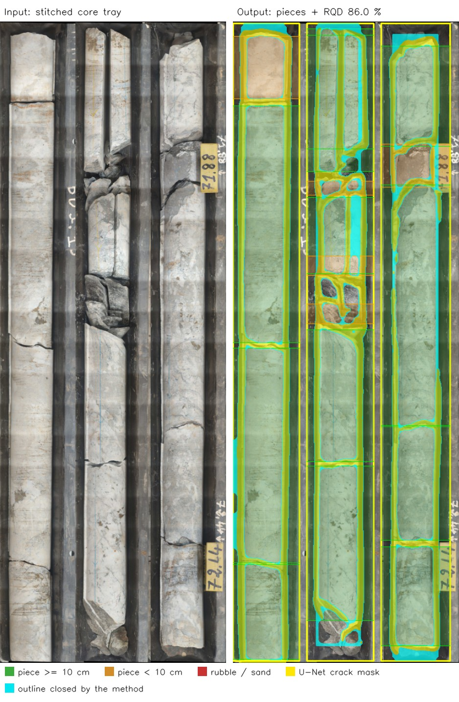

*A tray scanned by the robot (left) and the pipeline's output (right). Green pieces of 10 cm or more count towards RQD; this tray scores 86.0 % (Good). Yellow is the crack mask, cyan the outline the contour method closes.*

[Project and contribution](#at-a-glance) · [Engineering choices](#engineering-choices) · [Results](#models-and-recorded-results) · [Detailed walkthrough](#pipeline-in-detail) · [Quick start](#quick-start) · [Limitations](#limitations)

## At a glance

- **Problem:** geologists measure RQD by hand, tray after tray, with a tape measure. It is slow, and the result depends on who measures.
- **What I built:** the whole vision side of a robotic core scanner: image stitching, six trained models, the geometry that turns pixels into centimetres of intact rock, and the fusion of the image with a handheld XRF chemistry reading.
- **Data:** GSMI tray photographs and reviewed annotations for columns, cracks, pieces and zones; public rock-image datasets for lithology; USGS analyses and generated Benguerir readings for chemistry.
- **Deliverable:** one Python pipeline and command-line tool: tray photos in, annotated image and measurements out, with instant manual corrections.
- **Stack:** Python, OpenCV, NumPy, PyTorch, Ultralytics YOLO11 and YOLOv8, U-Net with a ResNet34 encoder, frozen DINOv2 features and scikit-learn.

## My role

GSMI is a team project for scanning drill-core trays. **I designed, annotated the data for, trained and integrated the vision components in this repository:** image stitching, six trained models, measurement logic and image/XRF fusion. Taha Ouadine built the robot's control interface and electronics, which are outside this repository.

That covers the whole chain: labels, data splits, architectures and losses, training, evaluation, and turning model outputs into physical measurements. Every model folder keeps its training script, settings, results and figures.

## How it works

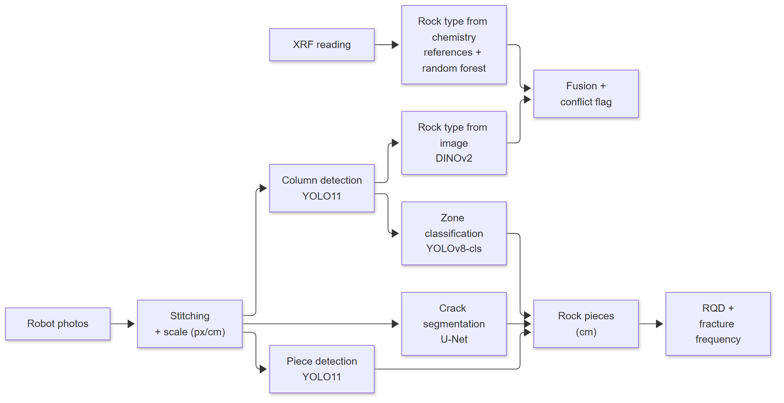

1. **Stitch and scale.** Use recorded robot positions when available, then a known image grid, then blind image matching. The scale converts pixels to centimetres.
2. **Find the core and its pieces.** Detect columns, then reconstruct pieces from U-Net crack masks or detect pieces directly with YOLO11. Optional zone classification identifies intact rock, rubble, sand and empty tray.
3. **Measure RQD.** Count the union of qualifying piece intervals, apply zone vetoes and join eligible pieces across column boundaries. Use the drilled run as the denominator when its depths are supplied; otherwise use the detected core span.
4. **Estimate rock type.** Average DINOv2 tile predictions and optionally combine them with XRF chemistry. Flag disagreements between the rock families preferred by the two sources.

## Engineering choices

- **Select models on the measurement task.** The U-Net checkpoint is chosen by the F1 of reconstructed pieces on whole validation trays. Its clDice loss penalises breaks in thin outlines.
- **Use physical scale.** Crack segmentation runs at 10 px/cm; piece lengths and geometric thresholds use the input image's scale.
- **Avoid counting the same depth twice.** Detector boxes are resolved into non-overlapping intervals, and the RQD numerator uses interval unions.
- **Cache inference for corrections.** `analyze()` returns the result and model state. `recompute()` applies manual corrections without running the networks again.
- **Keep chemistry choices explicit.** The default XRF scorer uses reference compositions (A3). The trained random forest (A4) is an optional Python API choice, combined with A3.
- **Evaluate transfer and confidence as well as accuracy.** Frozen DINOv2 scored below the best fine-tuned YOLO classifier on the image test set, but performed better on the small local-rock comparison and had lower calibration error. Those properties matter when the image probabilities are combined with chemistry.

See the [pipeline guide](pipeline/README.md) for methods, correction coordinates, outputs and fallback behaviour.

## Models and recorded results

Each result is recorded in the model's `results/metrics.json`, linked from its README.

| Component | Model | Evaluation set | Recorded result |
| --- | --- | --- | --- |
| [Columns](models/detection/columns_uni/README.md) | YOLO11s | 42 validation images, 204 columns | mAP@0.5 0.995; mAP@0.5:0.95 0.918 |
| [Cracks](models/segmentation/cracks_uni/README.md) | U-Net / ResNet34, run 2 | 35 validation images, 850 pieces | Reconstructed-piece F1 0.761 at threshold 0.45 |
| [Pieces](models/detection/pieces_uni/README.md) | YOLO11s | 26 validation images, 634 pieces | Piece recall 0.902; F1 0.863 at confidence 0.2 |
| [Zones](models/classification/zones-yolov8/README.md) | YOLOv8n-cls | 253 real validation patches | Accuracy 91.3%; macro-F1 88.7% |
| [Rock type from images](models/classification/lithology-dinov2/README.md) | Frozen DINOv2 + logistic regression | 679 test images | Accuracy 82.8%; macro-F1 83.2%; ECE 2.8% |
| [Rock type from chemistry](models/classification/xrf-randomforest/README.md) | Random forest, 200 trees | 5-fold CV: USGS states / synthetic Benguerir samples | Accuracy 85.3% / 87.5% |

The [stitcher](pipeline/image_processing/README.md) has a recorded example of 120 photographs processed in about 17 seconds, producing a 12.7 px/cm tray image.

## Pipeline in detail

The sections below explain what each component does, why it was chosen, and how it was evaluated. Each links to a model or pipeline README with the complete training settings, per-class results and execution instructions.

| Stage | Input → output | Main engineering question |
| --- | --- | --- |
| [1. Stitching](#1-stitching-the-robots-photos) | Overlapping photographs → tray image and scale | How can repetitive tray features be matched without losing or duplicating core? |
| [2. Columns](#2-column-detector) | Tray image → core-column boxes | Where does the core begin and end in each column? |
| [3. Cracks](#3-crack-segmentation) | Tray image → crack and outline mask | How can thin boundaries remain connected enough to reconstruct pieces? |
| [4. Pieces](#4-piece-detector) | Tray image → intact-piece boxes | Can direct detection provide a useful alternative to mask reconstruction? |
| [5. Zones](#5-zone-classifier) | Column patches → intact, rubble, sand or empty | Which apparent pieces should be excluded from intact-core measurements? |
| [6. RQD](#6-from-pieces-to-rqd) | Piece intervals and scale → RQD and fracture frequency | How should overlaps, missing core and column boundaries affect the measurement? |
| [7. Image lithology](#7-rock-type-from-the-image) | Rock tiles → visual class probabilities | Which representation transfers best to local rock photographs? |
| [8. XRF chemistry](#8-rock-type-from-xrf-chemistry) | Element concentrations → chemical class probabilities | How can composition and missing measurements be represented? |
| [9. Fusion](#9-fusion-and-conflict-flag) | Image and chemistry probabilities → decision and conflict flag | How should complementary evidence and disagreement be reported? |

### 1. Stitching the robot's photos

The robot photographs a tray in a grid of overlapping close-ups, about 120 images for the recorded full-tray scan. Core trays are difficult panorama subjects: dividers, tray walls and successive rock pieces can look alike. A plausible feature match can therefore place an image one piece or one column away from its true location.

The stitcher uses the strongest available positional information first: **recorded robot coordinates**, then **grid positions encoded in filenames**, then **blind image matching**.

<p align="center">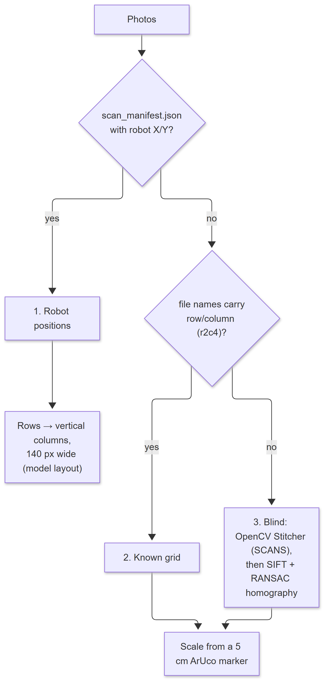</p>

For robot scans, the recorded positions constrain the layout while image overlap supplies the scale and small alignment corrections:

- **Scale and orientation by consensus.** Neighbouring photographs are compared under eight camera orientations. Match scores are accumulated across pairs before choosing a peak, reducing the influence of individual incorrect matches.
- **Joint placement.** A least-squares adjustment combines measured neighbour offsets with robot positions as anchors. Corrections remain close to the recorded layout.
- **Exposure and seams.** Overlap regions determine gains for each image and colour channel. Blending favours the centre of each image, where lens distortion is lower.
- **Model-ready layout.** The panorama is levelled and its rows become vertical core columns about 140 pixels wide. A second copy uses 560-pixel columns to retain texture for lithology classification.

| Recorded scan | Processing time | Output scale |
| --- | --- | --- |
| 120 photographs | About 17 seconds | 12.7 px/cm |

Grid and blind stitching instead look for a 5 cm ArUco marker. Their 50 px/cm fallback must be verified before using the image for measurements.

Full implementation and input formats: [image processing guide](pipeline/image_processing/README.md).

### 2. Column detector

The column detector locates each core column from its first recovered rock to its last, excluding the label areas above and below it. These boxes establish the regions used for piece assignment, zone classification and lithology tiles. Errors at the core ends also affect the detected-length denominator, so box overlap alone is not the only useful metric.

<p align="center">
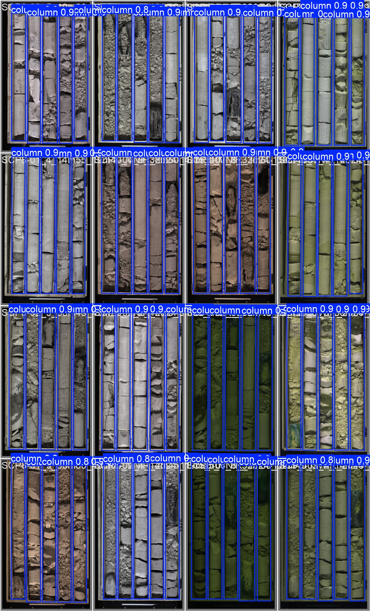
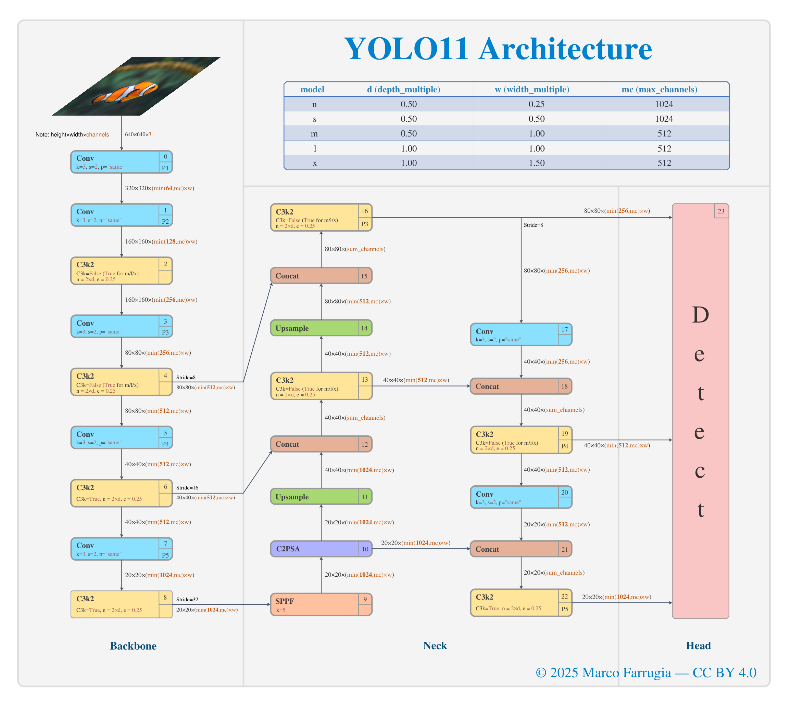
</p>

*Validation predictions and the YOLO11 architecture. Architecture attribution: [figure credits](docs/architectures/CREDITS.md).*

**YOLO11s**, with about **9.4 million parameters**, is fine-tuned from COCO weights at an input size of **1024 pixels**. The dataset contains **201 images and 965 column boxes**, spanning several imaging bands and both three- and five-column trays.

The split groups images by **physical tray**: scans of the same tray in different bands stay together. The 115 trays are divided into 92 training trays (159 images) and 23 validation trays (42 images).

| Validation columns | Precision | Recall | mAP@0.5 | mAP@0.5:0.95 |
| --- | --- | --- | --- | --- |
| 204 | 1.000 | 1.000 | 0.995 | 0.918 |

Precision and recall above are rounded at the reported best operating point. At the pipeline confidence threshold of **0.60**, median core-end errors are **4.6 pixels at the top** and **3.5 pixels at the bottom**, both below 0.5% of image height.

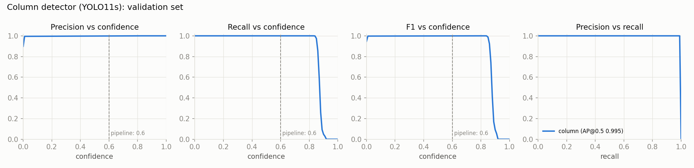

Full architecture, split, training settings and edge-error statistics: [column detector](models/detection/columns_uni/README.md).

### 3. Crack segmentation

The U-Net draws cracks and the outlines of intact pieces. The default `contour` method then reconstructs pieces from enclosed regions. A short break in an outline can connect two otherwise separate regions, which makes boundary continuity important to the final measurement.

<p align="center">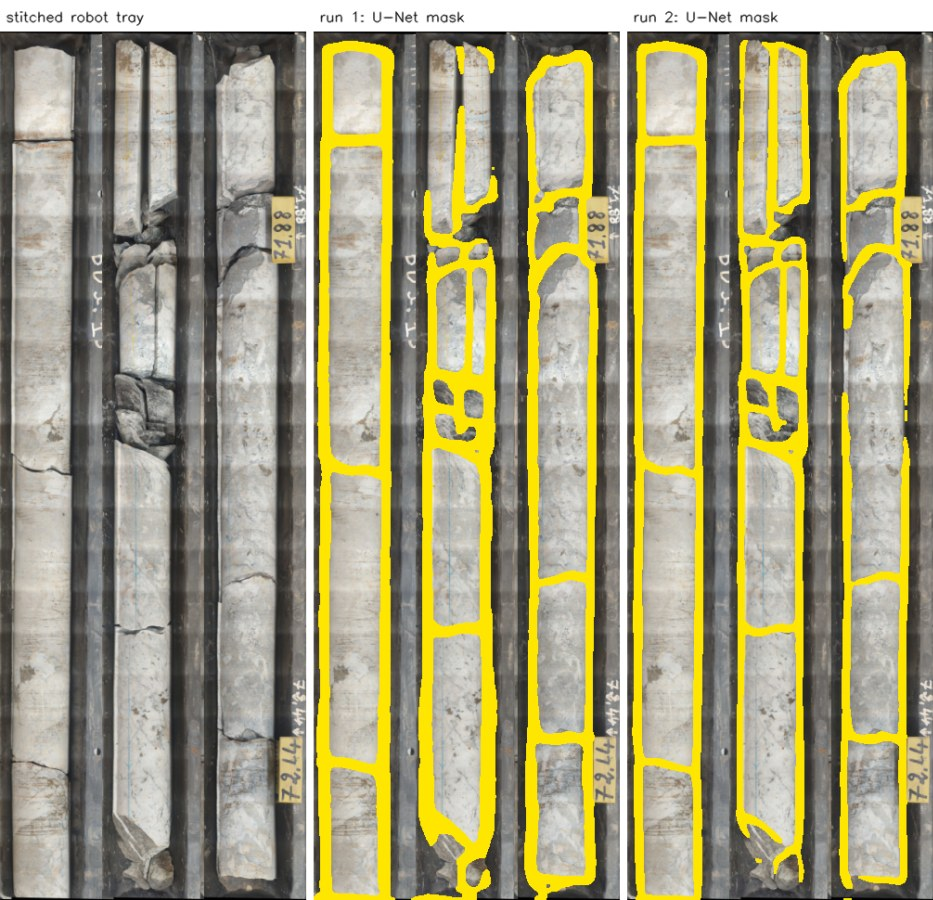</p>

*The U-Net predictions from the two recorded runs, before the geometry closes gaps in the outlines.*

The model is a **U-Net with an ImageNet-pretrained ResNet34 encoder**, about **24.4 million parameters**. It was trained on **188 photographs of 119 physical trays** from 13 boreholes. The split contains 153 training images and 35 validation images, grouped by physical tray.

Three choices connect training to the measurement task:

- **A common physical resolution: 10 px/cm.** Images are rescaled before training and inference so a physical feature has a consistent pixel size. Training uses 512 × 512 crops with scale augmentation; inference covers whole trays in overlapping bands.
- **A loss that accounts for continuity.** The loss combines 0.5 × binary cross-entropy, 0.25 × Dice and 0.25 × clDice. clDice compares thin centre-line structures, making broken outlines visible to the objective.
- **Checkpoint selection on reconstructed pieces.** Every five epochs, the contour method processes whole validation trays. Predicted pieces are matched one to one to annotated depth intervals at IoU ≥ 0.5, and the checkpoint with the best piece F1 is retained.

| Run | Piece precision | Piece recall | Piece F1 | Outline added by geometry | Pixel F1 |
| --- | --- | --- | --- | --- | --- |
| Run 1 | 0.768 | 0.752 | 0.760 | 28.4% | 0.746 |
| **Run 2: pipeline default** | **0.760** | **0.762** | **0.761** | **31.3%** | **0.750** |

Both rows use the **35 validation images, 850 annotated pieces and a 0.45 probability threshold**. The outline statistic measures how much of the reconstructed boundary the geometry had to add; it separates the network's contribution from post-processing. Run 2 uses an 80-epoch learning-rate cycle and retains epoch 55.

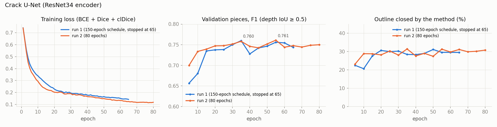

Faint cross-core cracks and dark rock against dark trays remain difficult. The [model guide](models/segmentation/cracks_uni/README.md) includes the architecture, threshold sweep, raw masks and examples showing exactly which outlines the contour method adds.

### 4. Piece detector

The second route finds intact pieces directly as bounding boxes. It avoids reconstructing every piece from a connected crack outline, providing a useful alternative when a missed boundary causes the mask-based method to merge neighbouring pieces.

<p align="center">
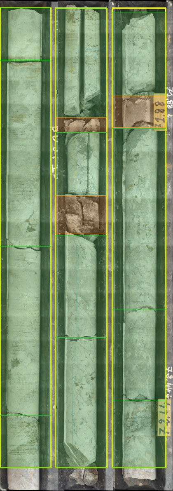
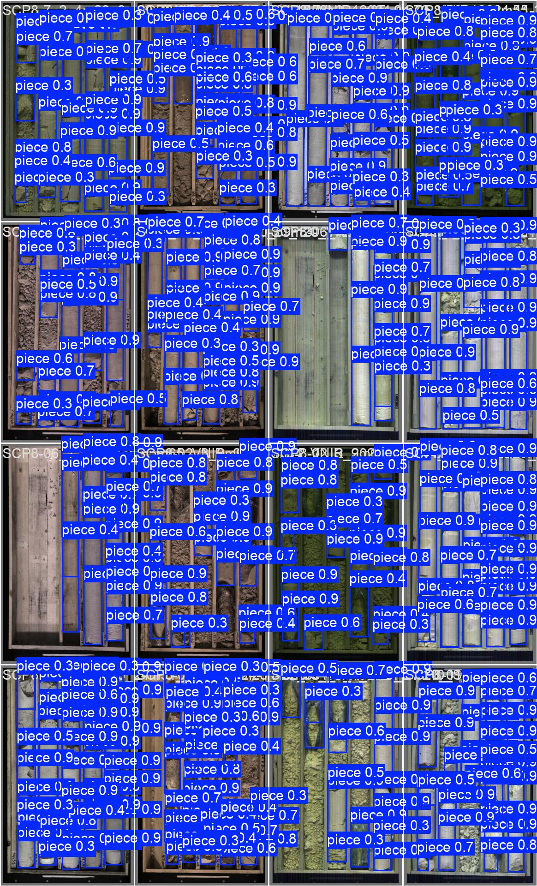
</p>

*Left: an example from the robot. Right: validation predictions. Green pieces qualify for RQD; orange pieces are shorter than 10 cm.*

**YOLO11s** is fine-tuned at **1024 pixels** on **132 photographs with 3,333 reviewed piece boxes**. The annotations represent pieces without overlapping depth intervals within a column. The physical-tray split contains 106 training images and 26 validation images, with 634 validation pieces.

At inference, boxes are assigned to columns and resolved from top to bottom. A large overlap is treated as a duplicate and the more confident box is kept; a smaller overlap is split at its midpoint. This produces measurable piece intervals from detector outputs.

| Evaluation at confidence 0.20 | Precision | Recall | F1 |
| --- | --- | --- | --- |
| Raw boxes | 0.735 | 0.907 | 0.812 |
| Pieces after column assignment and overlap resolution | **0.827** | **0.902** | **0.863** |

The recorded piece-level evaluation has **0% double-counted depth** at this threshold. Raw detector mAP@0.5 is **0.897**. Reporting both evaluations makes clear what improves when the model output is converted into the intervals used by RQD.

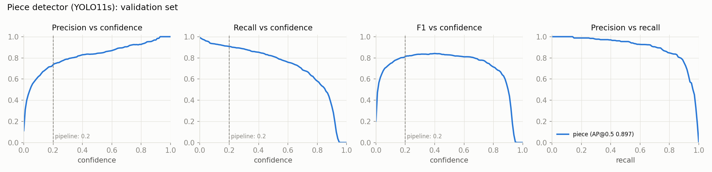

The robot-tray example also shows a useful failure case: a depth label is detected as a short piece. It does not contribute to the intact-length numerator, but it affects the fracture count. Full results and the example analysis: [piece detector](models/detection/pieces_uni/README.md).

### 5. Zone classifier

The zone classifier labels stretches of each column as **intact rock, rubble, sand or empty tray**. Its purpose is to distinguish an intact piece from an area where fragments or loose material happen to form a large region in another model's output.

**YOLOv8n-cls**, about **1.4 million parameters**, processes **128 × 128 patches** with 50% overlap down each resized column. Rows inherit the class of the nearest window, and short runs are absorbed into neighbouring zones.

<p align="center">
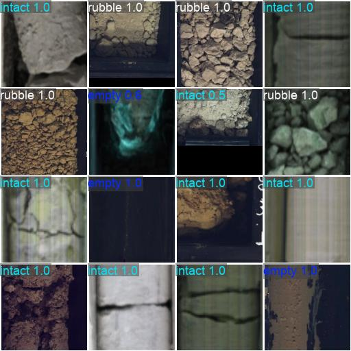
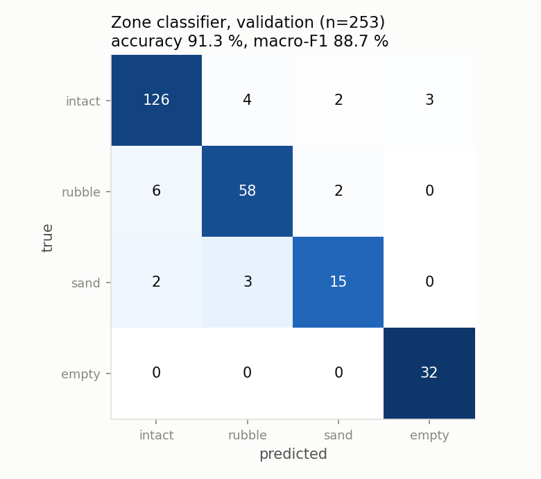
</p>

The training set starts with **1,360 real patches**. Minority-class augmentation increases the training set to 2,142 patches, while validation uses **253 real patches only**. Sand is particularly scarce, with 45 original training patches and 20 validation patches.

| Accuracy | Macro-F1 | Intact recall | Rubble recall | Sand recall | Empty recall |
| --- | --- | --- | --- | --- | --- |
| 91.3% | 88.7% | 93.3% | 87.9% | 75.0% | 100% |

For RQD, the important confusion is between intact and broken material: the validation report records **8 broken patches called intact** and **9 intact patches called broken**. When enabled, confident rubble or sand zones veto overlapping pieces; empty zones mark them as void. Manual intact boxes take precedence.

Full training settings, class balance, split limitations and learning curves: [zone classifier](models/classification/zones-yolov8/README.md).

### 6. From pieces to RQD

The measurement layer converts model outputs into physical lengths. It supports three piece-extraction methods:

| Method | How pieces are obtained | Main sensitivity |
| --- | --- | --- |
| `contour` — default | Close small gaps in crack outlines and retain enclosed regions with sufficiently solid interiors | Missing boundaries can merge pieces |
| `connected_components` | Extend crossing fractures across the core, then separate the remaining rock regions | Depends on which fractures are judged to cross the core |
| `piece_detect` | Resolve direct detector boxes into depth intervals | Missed pieces, duplicate boxes and labels mistaken for rock |

```text
RQD (%) = 100 × length of the union of qualifying piece intervals / denominator length
```

A piece qualifies at **10 cm or longer**, subject to the zone rules. Overlapping qualifying intervals contribute their combined coverage once. The tray denominator is the drilled run when valid start and end depths are supplied; otherwise it is estimated from the detected core span. Gaps inside the span remain in the denominator, and a supplied run length also enables core-recovery reporting.

Pieces meeting the boundary conditions at the bottom of one column and the top of the next can be chained before applying the 10 cm threshold. For example, two 6 cm halves can qualify as a 12 cm piece. This encodes the assumed tray reading order; the overlay remains important for checking that a join is appropriate.

**Fracture frequency** is reported alongside RQD because the threshold discards information about shorter pieces. A sequence of 9 cm pieces and much finer fragments can both have 0% RQD, while their fracture counts differ. Chained column boundaries are not counted as fractures.

<p align="center">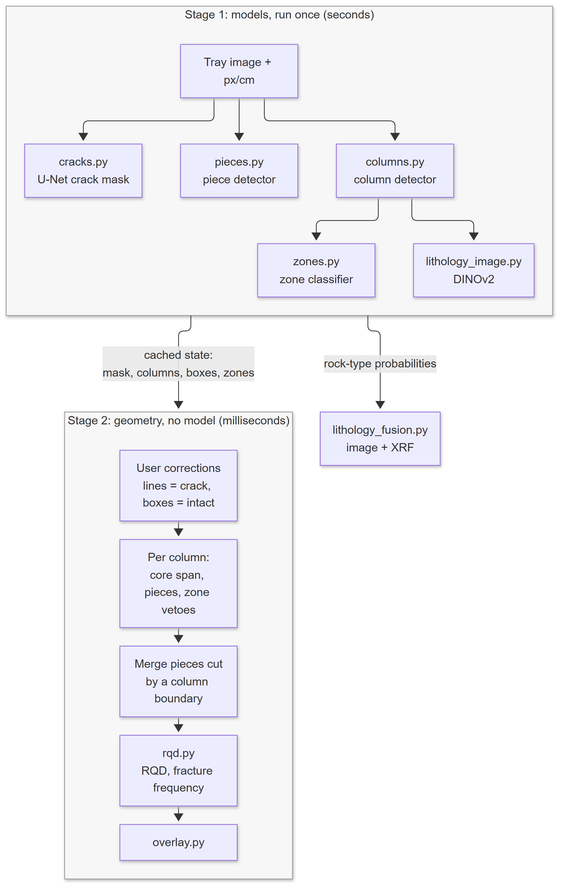</p>

The two-stage design also supports review: `analyze()` runs the selected models and returns cached state; `recompute()` applies a geologist's crack lines or intact boxes to that state and reruns the geometry. The neural networks do not run again for those corrections.

Full measurement rules, Python examples, output fields and fallback behaviour: [pipeline guide](pipeline/README.md).

### 7. Rock type from the image

The image model classifies square tiles cut inside the core band, then averages their probabilities across a tray. Its six classes are **limestone, dolomitic limestone, marl, flint, out of series and no rock**. Empty-tray and label tiles are filtered from the average when rock tiles are available.

<p align="center">
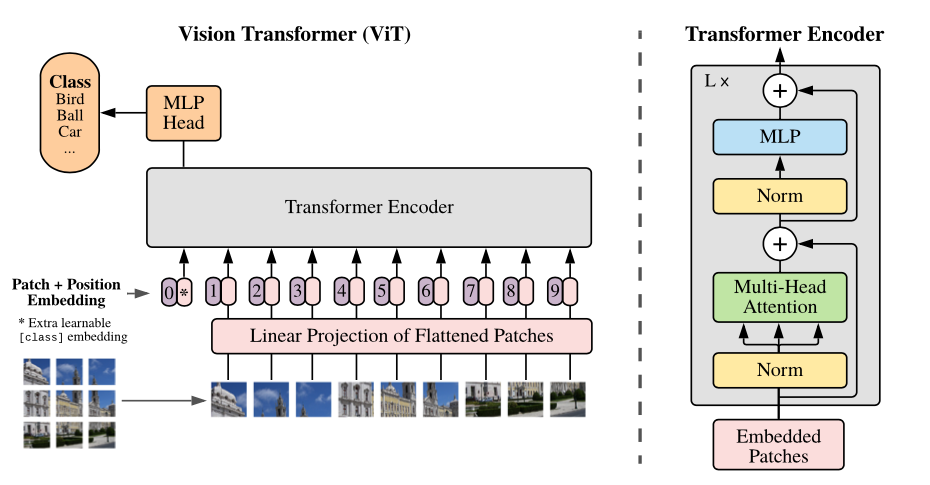
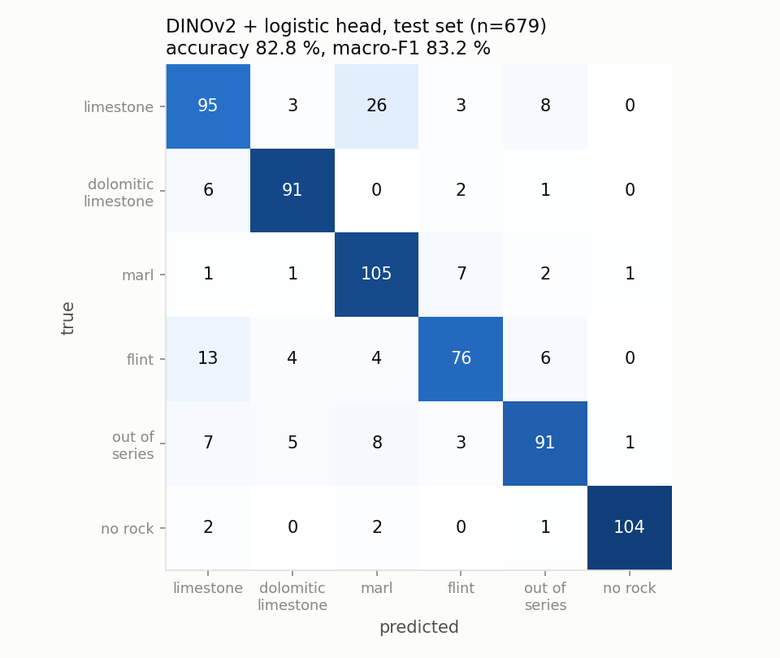
</p>

*Vision Transformer overview and the classifier's test confusion matrix. Architecture attribution: [figure credits](docs/architectures/CREDITS.md).*

The backbone is **DINOv2 ViT-S/14, frozen**. Each 224 × 224 RGB tile becomes a 384-dimensional feature vector, which is L2-normalised and passed to a logistic-regression head. Only the head's **2,310 parameters** are trained. Its regularisation is selected by validation macro-F1.

The dataset combines public core and specimen photographs from Australia, China, Kaggle and Wikimedia, plus GSMI no-rock patches. It contains **3,000 training, 641 validation and 679 test images**. Preparation groups related drillholes, specimens and similar photographs to reduce leakage between splits.

**Why choose frozen features?** The strongest image-test accuracy came from a fine-tuned YOLOv8 classifier, but its advantage did not carry into the small local-rock comparison. DINOv2 also produced better-calibrated probabilities, which matters for multiplying them with chemistry probabilities.

| Model | Test accuracy | Macro-F1 | Correct on 12 Benguerir photos | Calibration error (ECE) |
| --- | --- | --- | --- | --- |
| **DINOv2 + logistic regression** | **82.8%** | **83.2%** | **6 / 12** | **2.8%** |
| YOLOv8n-cls, fine-tuned | 84.5% | 85.1% | 3 / 12 | 6.6% |
| YOLO11s-cls, fine-tuned | 79.1% | 79.8% | 2 / 12 | 12.6% |

DINOv2's macro ROC-AUC is **0.970** on the 679-image test set. A remaining failure is pale local dolomite being read as limestone, since much of the training dolomite is dark core.

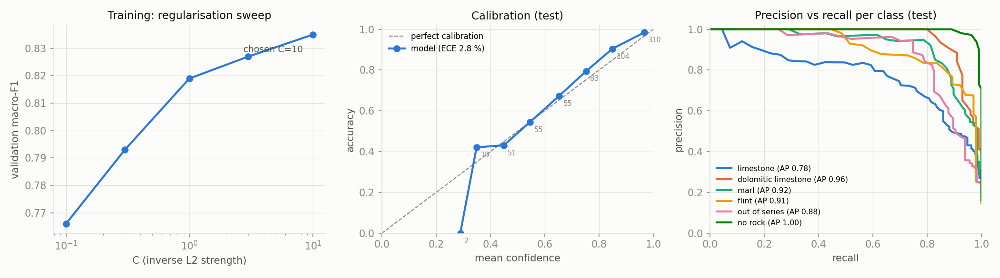

Full architecture, data sources, class metrics and model comparisons: [image lithology](models/classification/lithology-dinov2/README.md).

### 8. Rock type from XRF chemistry

A handheld XRF analyser measures elemental composition at a point on the core. Chemistry provides evidence that a photograph alone cannot resolve reliably, including phosphate content and magnesium-rich carbonate compositions.

There are two chemistry scorers. **A3**, the pipeline default, compares the reading with reference compositions. **A4**, the trained option, is a **200-tree random forest** used in combination with A3 through the fusion API.


The forest receives **22 features**: the 21 pairwise log-ratios of seven oxide concentrations, plus a flag indicating that MgO was not measured. Ratios preserve relative composition under common multiplicative dilution. Missing measurements are handled explicitly rather than interpreted as confirmed zero concentrations.

Training combines **4,802 USGS laboratory analyses** with **2,700 synthetic Benguerir readings**, generated from reference statistics with simulated instrument noise and detection limits. Cross-validation holds out complete US states for the USGS data; the synthetic readings are divided by sample index.

| Evaluation subset | Samples | Accuracy | Macro-F1 |
| --- | --- | --- | --- |
| USGS analyses, held-out states | 4,802 | 85.3% | 81.8% |
| Synthetic Benguerir readings, held-out samples | 2,700 | 87.5% | 87.5% |

<p align="center">


</p>

The forest recognises **95.7% of out-of-series rocks** in the held-out US-state evaluation. The main Benguerir confusions involve phosphate-bearing mixtures, including two classes represented by mixtures of reference end-members.

Full feature construction, reference data, cross-validation and per-class results: [XRF random forest](models/classification/xrf-randomforest/README.md).

### 9. Fusion and conflict flag

The image and chemistry models describe rock at different levels of detail. The image model has a limestone class, for example, while the chemistry targets distinguish limestone from phosphatic limestone. Before combination, each visual class distributes its probability across compatible chemical targets.

```text
P(rock) ∝ P_image(rock)^w_image × P_XRF(rock)^w_xrf
```

The weighted product is computed in log space and normalised over the target classes. It allows chemistry to refine a visually plausible family without requiring the image model to recognise every chemical mixture.

The pipeline also reports a **conflict flag** when chemistry rules out the rock family preferred by the image. For example, a carbonate-looking surface and a strongly siliceous reading can trigger a review even though the fusion still returns a top class. The result exposes the chosen class, confidence, evidence source and conflict status.

The default analysis uses A3 chemistry. Selecting `xrf_method="a3xa4"` in the fusion API adds the random forest; simply placing its weights on disk does not enable it. With no usable chemistry, the image can still provide a decision. The standalone fusion API also supports chemistry-only decisions.

Implementation and examples: [fusion module](pipeline/lithology_fusion.py) and [pipeline guide](pipeline/README.md#rock-type-image--xrf).

## Quick start

Use **Python 3.10 or newer** and run commands from this folder, which contains `pyproject.toml`.

### Demo and tests

The synthetic demo and tests need no trained weights or robot hardware.

**Windows PowerShell**

```powershell
python -m venv .venv
.\.venv\Scripts\python.exe -m pip install -e ".[test]"
.\.venv\Scripts\python.exe -m pipeline.cli demo --output demo-output
.\.venv\Scripts\python.exe -m pytest -q
```

**Linux / macOS**

```bash
python -m venv .venv
.venv/bin/python -m pip install -e ".[test]"
.venv/bin/python -m pipeline.cli demo --output demo-output
.venv/bin/python -m pytest -q
```

The demo writes `stitched.png`, `pieces.png` and `results.json` under `demo-output/`. It exercises stitching, geometry, RQD and fusion using synthetic inputs; it does not evaluate the trained models.

### Analyze a real tray

With the trained weights in `weights/` (file names in [pipeline/weights.py](pipeline/weights.py)):

```bash
python -m pip install -e ".[inference]"
python -m pipeline.cli stitch scans/tray_01/ --output tray.png
python -m pipeline.cli analyze tray.png --pixels-per-cm 12.7 --zones --lithology --output runs/tray_01
```

All options (RQD method, XRF reading, drilled depths) and the weight files each feature needs: [command-line reference](pipeline/README.md#command-line).

## Repository guide

| Folder or file | Contents |
| --- | --- |
| [pipeline/](pipeline/README.md) | Inference, piece geometry, RQD, fusion and CLI |
| [pipeline/image_processing/](pipeline/image_processing/README.md) | Stitching and scale estimation |
| [models/detection/](models/detection/README.md) | Column and piece detectors |
| [models/segmentation/](models/segmentation/README.md) | Crack U-Net |
| [models/classification/](models/classification/README.md) | Zone, image-lithology and XRF classifiers |
| [tests/test_pipeline.py](tests/test_pipeline.py) | Geometry, stitching, fusion and CLI checks |
| [tools/make_figures.py](tools/make_figures.py) | Regenerate result figures from saved histories and metrics |
| [docs/diagrams/](docs/diagrams/README.md) | Mermaid sources and rendered pipeline diagrams |
| [docs/architectures/CREDITS.md](docs/architectures/CREDITS.md) | Architecture figure sources and licences |

For training, install `.[training]` and follow the data and execution notes in the relevant model README. For result figures, install `.[figures]` and run `python tools/make_figures.py`; this overwrites generated figures in model `results/` folders.

## Data and reproducibility

- **Core geometry and zones:** GSMI tray photographs, annotated by me. The images are not published.
- **Image lithology:** public image sources listed in the [model's data section](models/classification/lithology-dinov2/README.md#data). The prepared image dataset is not bundled.
- **XRF chemistry:** the included [USGS CSV](models/classification/xrf-randomforest/data/ngdb_sedimentary.csv) contains 4,802 analyses. The training script generates 2,700 synthetic Benguerir readings from reference statistics.
- **Recorded evidence:** model folders contain training/evaluation code, metrics and figures; epoch-based models also include training histories. Retraining image models requires their original data. Exact reproduction also depends on dependency versions, pretrained assets and hardware.

The [CI workflow](.github/workflows/tests.yml) runs the tests and synthetic demo on Python 3.12 when this folder is used as the repository root.

## Limitations

- RQD has not been validated against a geologist's manual log on unseen boreholes. Image-derived core span is an estimate; provide drilled depths when available.
- Scale errors change every measured length. Without robot-position calibration or a detected marker, the stitcher returns a **50 px/cm fallback**, which must be checked before measurement.
- Validation trays come from the same boreholes as the training trays; new sites are tested directly with the robot.
- Faint cracks, dark core, labels and incorrect boundary joins can change the piece count and RQD. Review the overlay and use corrections where needed.
- Pale local dolomite can be confused with limestone. The 12-photo Benguerir comparison is exploratory, and the 87.5% XRF score is on synthetic readings, not independent field measurements.

## License

Code is released under the [MIT License](LICENSE). Datasets, pretrained models and third-party figures retain their own licences; figure attribution is in [CREDITS.md](docs/architectures/CREDITS.md).
