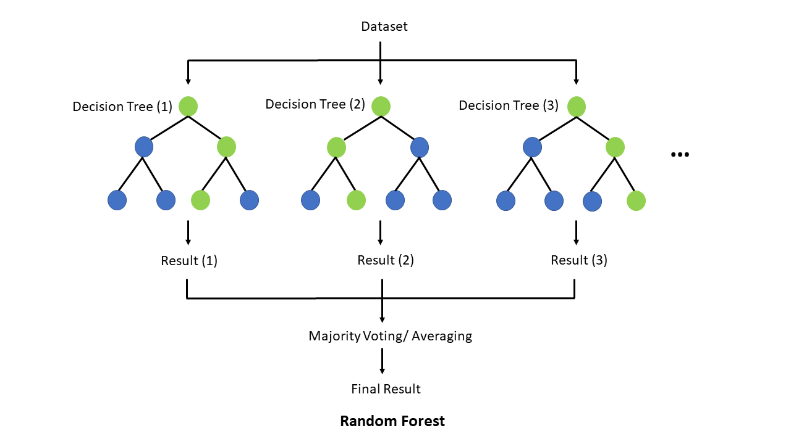
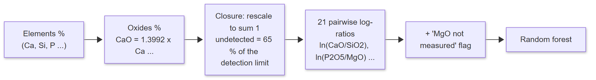
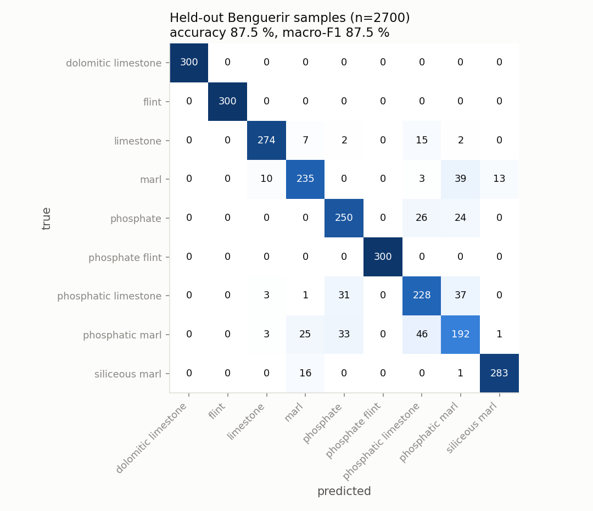
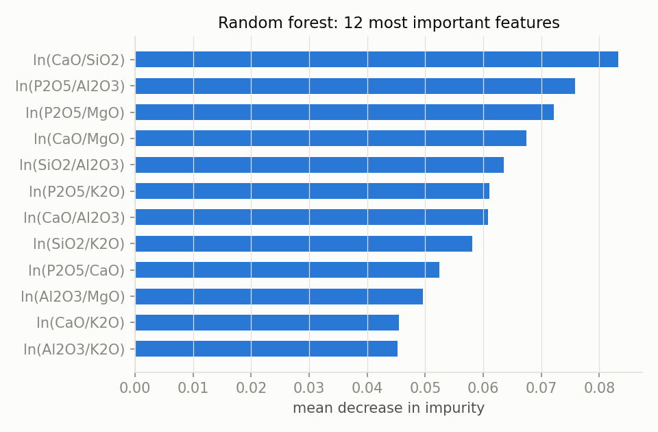

# Rock type from chemistry: random forest on XRF log-ratios

[Project overview](../../../README.md) · [Classification](../README.md) · [Pipeline guide](../../../pipeline/README.md)

A handheld XRF analyser gives the elemental composition of the core at a point. This model turns it into rock-type probabilities, which [lithology_fusion.py](../../../pipeline/lithology_fusion.py) combines with the image.

The default chemical scorer needs no training: it measures the distance to published reference compositions ("A3"). This forest ("A4") is an optional second opinion, multiplied with A3. Its strength is recognising rocks that do not belong to the deposit.

| Property | Value |
| --- | --- |
| Task | tabular classification, 9 Benguerir rock types + out of series |
| Model | scikit-learn `RandomForestClassifier`, 200 trees |
| Input | 7 oxides (P₂O₅, CaO, SiO₂, Al₂O₃, Fe₂O₃, MgO, K₂O) → 22 features |
| Output | class probabilities; classes it never saw get a small floor (0.01) |
| Used in | [pipeline/lithology_fusion.py](../../../pipeline/lithology_fusion.py) (`a4_probs`, method `a3xa4`) |

## Architecture



*"Random forest explain" by TseKiChun, [Wikimedia Commons](https://commons.wikimedia.org/wiki/File:Random_forest_explain.png), [CC BY-SA 4.0](https://creativecommons.org/licenses/by-sa/4.0/).*

200 decision trees, each grown on a bootstrap sample of the training data and choosing each split among √22 ≈ 4 random features. The forest's class probabilities are the average of the trees' votes.

## Features



Log-ratios come from compositional data analysis (Aitchison). Percentages are relative: if one oxide goes up, the others must go down, so single values are misleading and only ratios between parts carry information. Ratios are invariant to a common multiplicative dilution of the measured oxides. That mathematical property does not remove all moisture, porosity or instrument effects. The flag exists because the handheld analyser often cannot detect MgO below 1.5 %, and "not measured" is not the same as "zero".

## Data

| Source | Content |
| --- | --- |
| [USGS National Geochemical Database](https://mrdata.usgs.gov/ngdb/rock/) (public domain), in [data/ngdb_sedimentary.csv](data/ngdb_sedimentary.csv) | 4,802 lab analyses labelled by rock name: limestone 1,538, flint (chert) 563, dolomite 547, phosphorite 154, and 2,000 foreign rocks (granite, basalt, sandstone, shale…) |
| Published Benguerir lab XRF: *Minerals* 2026, 16(6), 619 and *Buildings* 2024, 14(8), 2375 | mean ± SD per rock type, sampled 300 times per class with handheld-analyser noise (6 % relative, 15 % for MgO) and its detection limits. The only source for marl, siliceous marl, phosphate flint and the phosphatic mixtures. |

## Training

| Setting | Value |
| --- | --- |
| Trees | 200 |
| `min_samples_leaf` | 2 (no leaf decided by a single analysis) |
| `class_weight` | balanced |
| Validation | 5-fold cross-validation **holding out whole US states**, so near-identical analyses from one area never sit on both sides |

Script: [train.py](train.py). It rebuilds the dataset features, cross-validation and final forest. Exact reproduction depends on the input data and library versions.

## Results

5-fold cross-validation holds out whole states for the USGS analyses and splits the synthetic Benguerir readings by sample index. The Benguerir folds share the same reference distributions; they are not independent field samples. `train.py` writes all numbers to [results/metrics.json](results/metrics.json).

| Held-out set | n | Accuracy | Macro-F1 |
| --- | --- | --- | --- |
| Synthetic Benguerir readings | 2,700 | 87.5 % | 87.5 % |
| US states | 4,802 | 85.3 % | 81.8 % |

Per class on the held-out synthetic Benguerir readings:

| Class | Precision | Recall | F1 |
| --- | --- | --- | --- |
| dolomitic limestone | 1.000 | 1.000 | 1.000 |
| flint | 1.000 | 1.000 | 1.000 |
| phosphate flint | 1.000 | 1.000 | 1.000 |
| siliceous marl | 0.953 | 0.943 | 0.948 |
| limestone | 0.945 | 0.913 | 0.929 |
| phosphate | 0.791 | 0.833 | 0.812 |
| marl | 0.828 | 0.783 | 0.805 |
| phosphatic limestone | 0.717 | 0.760 | 0.738 |
| phosphatic marl | 0.651 | 0.640 | 0.645 |



The errors sit almost entirely among the phosphate-bearing classes: phosphate, phosphatic limestone and phosphatic marl. Two of these classes have no published analysis and are modelled as 50/50 mixtures of their end-members, so they overlap by construction. On US rocks the weakest class is flint (recall 0.56): chert analyses vary widely.



A random forest is not trained in epochs: each tree is grown once, so there is no training curve. The cross-validation above is how it is judged.

Other tests:

| Test | Result |
| --- | --- |
| Foreign rocks (out of series) in held-out US states | recognised 95.7 % of the time |
| Reference scorer A3 (no training) on the same Benguerir samples | 84.4 %, vs 87.5 % for the forest |
| Forest trained on US data only, tested on Benguerir | fails: calls Benguerir dolomite "limestone" |
| A3 references applied to US rocks | 50 % |

The last two rows show that **rock chemistry is basin-specific**: the tested US-only model transferred poorly to Benguerir. Benguerir rocks carry 2–4 % P₂O₅, far more than typical US limestones. The combined training set performed better across these two evaluation distributions.

Log of the original training run: [results/train_world_chemistry.txt](results/train_world_chemistry.txt).

## Run this model

Install `.[training]` from the project root. This model uses the included USGS CSV and generates its Benguerir samples in code, so it does not require the private image datasets.

```bash
python models/classification/xrf-randomforest/train.py
```

The script runs cross-validation, overwrites `results/metrics.json`, and exports `runs/xrf_a4_world.joblib` inside this model folder. Copy the export to `weights/lithology/xrf_a4_world.joblib` for inference.

The forest is **not enabled automatically** when its file exists. Use `decide(image_probs, elements, xrf_method="a3xa4")` from [pipeline/lithology_fusion.py](../../../pipeline/lithology_fusion.py); the CLI and `analyze()` use A3 by default. The fusion API expects elemental weight percentages, while the forest's internal features use oxide percentages.

The 87.5% Benguerir score describes generated readings from the training reference distributions. Independent measurements from new boreholes are still needed to establish field performance.
