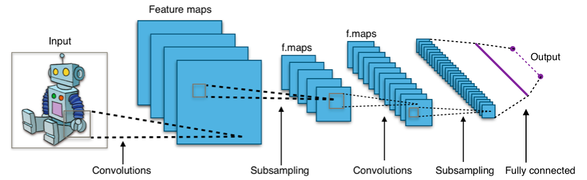
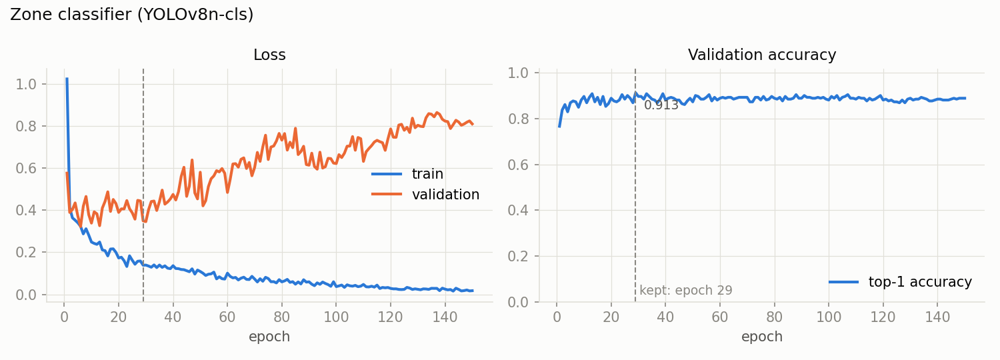

# Zone classifier: YOLOv8n-cls

[Project overview](../../../README.md) · [Classification](../README.md) · [Pipeline guide](../../../pipeline/README.md)

Labels each stretch of a column as intact rock, rubble, sand or empty tray. Its uses in the pipeline:

- rows it sees as rock help define the core length, which is the RQD denominator;
- a confident rubble, sand or empty zone vetoes the pieces lying in it, because broken material must never count as intact rock;
- if no crack mask is available, RQD is computed from its intact zones alone.

| Property | Value |
| --- | --- |
| Task | image classification, 4 classes |
| Architecture | YOLOv8n-cls, 1.4 M parameters, ImageNet-pretrained |
| Input | 128×128 patch: the column is resized to 128 px wide and a window slides down it with 50 % overlap |
| Output | class probabilities per window → every row takes the nearest window's class → zones shorter than 5 cm are absorbed by their neighbour |
| Used in | [pipeline/zones.py](../../../pipeline/zones.py) |

## Architecture



*"Typical CNN" by Aphex34, [Wikimedia Commons](https://commons.wikimedia.org/wiki/File:Typical_cnn.png), [CC BY-SA 4.0](https://creativecommons.org/licenses/by-sa/4.0/).*

YOLOv8n-cls is a convolutional classifier with this structure:
- **Convolutions and subsampling:** a YOLOv8 backbone in the **n** size. The [column and piece detectors](../../detection/README.md) use YOLO11s. It turns the 128×128 patch into small feature maps that describe texture: smooth solid rock, broken fragments, loose grains, empty tray.
- **Fully connected:** a 1×1 convolution to 1,280 channels, global average pooling, dropout (0.25), then a linear layer to the **4 classes**, and softmax.

## Data

Patches cut from GSMI core-tray columns, labelled by me.

| Dataset split | intact | rubble | sand | empty |
| --- | --- | --- | --- | --- |
| Train, real | 765 | 370 | 45 | 180 |
| Train, after offline augmentation | 765 | 459 | 459 | 459 |
| Validation (real only) | 135 | 66 | 20 | 32 |

Sand was rare. The minority classes were augmented offline up to 60 % of the majority class, with 24 transforms (brightness, contrast, noise, blur, CLAHE, flips, rotations and combinations). The validation set contains only real patches. The script splits individual patches within each class (85% training, or 70% for sand), not whole trays or boreholes. Correlated patches can therefore appear on both sides; this score does not measure transfer to unseen trays.

**Domain rule behind the settings:** confusing sand with rubble is harmless (both are broken), but confusing either with intact breaks RQD. Strong brightness and contrast augmentation, label smoothing and mixup target that boundary.

## Training

| Setting | Value |
| --- | --- |
| Starting weights | `yolov8n-cls.pt` (ImageNet) |
| Frozen layers | none |
| Epochs | 150, no early stopping |
| Image size / batch | 128 / 16 |
| Optimizer | Ultralytics `auto`, which selected AdamW, lr 0.00125 |
| Regularisation | dropout 0.25, weight decay 5e-4, label smoothing 0.1, mixup 0.15, random erasing 0.15 |
| Augmentation | HSV (s 0.5, v 0.4), rotation ±15°, scale 0.3, vertical and horizontal flips |

Full settings: [results/args.yaml](results/args.yaml). Script: [train.py](train.py).

## Results

The kept weights (epoch 29) evaluated on the 253 real validation patches. Reproduce with [evaluate.py](evaluate.py); all numbers are in [results/metrics.json](results/metrics.json).

**Accuracy 91.3 %, macro-F1 88.7 %.**

| Class | Support | Precision | Recall | F1 |
| --- | --- | --- | --- | --- |
| intact | 135 | 0.940 | 0.933 | 0.937 |
| rubble | 66 | 0.892 | 0.879 | 0.885 |
| sand | 20 | 0.789 | 0.750 | 0.769 |
| empty | 32 | 0.914 | 1.000 | 0.955 |

**The error that matters for RQD:** 8 broken patches (rubble or sand) called intact, and 9 intact patches called broken.


### Training



After epoch 30 the validation loss climbs while accuracy stays near 89 %. The model does not make more mistakes; it becomes over-confident in the ones it makes, a sign of overfitting to the augmented copies. The checkpoint kept is the best-accuracy epoch (29), before most of that drift. Early stopping on validation loss would have been the better setting. The sand class has only 20 validation patches, so its score is uncertain.

## Run this model

Install `.[training]` from the project root. Supply real labelled images in `models/classification/zones-yolov8/data/zones/<class>/`, where `<class>` is `intact`, `rubble`, `sand` or `empty`.

```bash
python models/classification/zones-yolov8/train.py
python models/classification/zones-yolov8/evaluate.py --weights models/classification/zones-yolov8/runs/zone_cls_v4/weights/best.pt --data models/classification/zones-yolov8/data/zone_cls_v4/val
```

Training rebuilds `data/zone_cls_v4/`, augments only the training split, and writes to `runs/zone_cls_v4/` within this model folder. It uses GPU `device=0` and can overwrite an existing run. Evaluation overwrites `results/metrics.json`.

Deploy the chosen checkpoint as `weights/zone_classifier_v8.pt` and enable `--zones`. The original [training history](results/results.csv) accompanies the recorded metrics.
