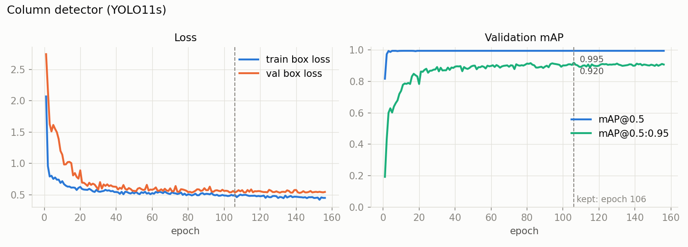

# Column detector: YOLO11s

[Project overview](../../../README.md) · [Detection](../README.md) · [Pipeline guide](../../../pipeline/README.md)

Finds the core columns of a tray, each one from where the core starts to where it ends. These boxes define the regions used for piece assignment, zone classification and rock-surface tiles, and their end positions contribute to the detected core length.

| Property | Value |
| --- | --- |
| Task | object detection, 1 class (`column`) |
| Architecture | YOLO11s, 9.4 M parameters, COCO-pretrained |
| Input | tray photo, letterboxed to 1024×1024 |
| Output | one box per column: its left and right edges, and the core's top and bottom ends (the label zones above and below the core are left out) |
| Used in | [pipeline/columns.py](../../../pipeline/columns.py) |

## Architecture


*Source and licence: [docs/architectures/CREDITS.md](../../../docs/architectures/CREDITS.md).*

This repository uses the **s** (small) size: depth ×0.50, width ×0.50. The head predicts 1 class instead of 80.

## Data

201 tray photographs (VNIR, SWIR, MWIR and RGB scans; 3- and 5-column trays) provided by GSMI, 965 column boxes, annotated by me.

The split is made **by physical tray**, not by image: the scans of one tray in different bands look almost identical, so they all go to the same side. 115 trays: 92 for training (159 images), 23 for validation (42 images, 204 columns). Seed 42.

## Training

| Setting | Value |
| --- | --- |
| Starting weights | `yolo11s.pt` (COCO) |
| Frozen layers | none: the whole network is fine-tuned |
| Epochs | 200 max, early stopping after 50 epochs without improvement (stopped at 156, best at 106) |
| Image size / batch | 1024 / 8 |
| Optimizer | AdamW, lr 0.001, set explicitly |
| Augmentation | Ultralytics defaults (mosaic, HSV, scale, translation, horizontal flip) plus vertical flip 0.5; no rotation, which would tilt the columns inside straight boxes; mosaic off for the last 20 epochs |

Full settings: [results/args.yaml](results/args.yaml). Script: [train.py](train.py).

## Results

The kept weights re-evaluated on the validation set: 23 trays, 42 images, 204 columns. Reproduce with [evaluate.py](evaluate.py); all numbers are in [results/metrics.json](results/metrics.json).

| Operating point | Precision | Recall | F1 | mAP@0.5 | mAP@0.5:0.95 |
| --- | --- | --- | --- | --- | --- |
| Best operating point | 1.000 | 1.000 |  | 0.995 | 0.918 |
| At the pipeline threshold (conf 0.6) | 0.999 | 1.000 | 0.999 |  |  |

**Core ends.** Each annotated column was matched to its predicted box, and the top and bottom edges were compared:

| Edge error | Median | Mean | 90th percentile | Max |
| --- | --- | --- | --- | --- |
| Top end (px) | 4.6 | 8.0 | 23.6 | 37.7 |
| Bottom end (px) | 3.5 | 7.7 | 29.8 | 38.1 |
| Top end (% of image height) | 0.45 | 0.66 | 1.72 | 2.80 |
| Bottom end (% of image height) | 0.32 | 0.68 | 2.56 | 3.47 |

The median error is under 0.5 % of the image height at each end; the worst column is off by 3.5 %.

### Training



### Validation


F1 stays above 0.99 for any confidence between 0.05 and 0.8, so the pipeline threshold of 0.6 is not a fine-tuned value. The validation set is small (23 trays from the same boreholes as the training trays), so these scores describe performance on trays like the training ones and do not establish performance on a new site. The Python API falls back to a brightness-based five-column layout when detection fails or finds no boxes. The CLI requires the column weights before starting analysis.

## Run this model

From the project root, install `.[training]`. Training expects reviewed JSON records under this model's `completing annotation/data/unified/`, with accessible source image paths. Those private inputs are excluded from publication.

```bash
python models/detection/columns_uni/train.py
python models/detection/columns_uni/evaluate.py --weights models/detection/columns_uni/runs/columns_uni/weights/best.pt --data models/detection/columns_uni/data/yolo/dataset.yaml
```

The training script rebuilds its generated `data/yolo/` directory and uses GPU `device=0`; adjust that setting if needed. Evaluation overwrites `results/metrics.json`. Copy the chosen checkpoint to `weights/column_yolo11s.pt` for deployment. The [saved history](results/results.csv) and [recorded settings](results/args.yaml) describe the original run; a later training run may use a suffixed output directory.
