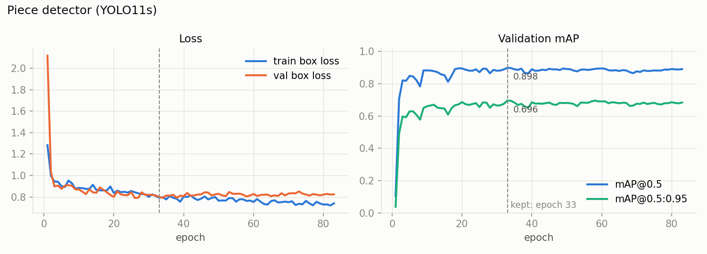

# Piece detector: YOLO11s

[Project overview](../../../README.md) · [Detection](../README.md) · [Pipeline guide](../../../pipeline/README.md)

Detects every intact rock piece directly as a box. It is the `piece_detect` RQD method, an alternative to rebuilding pieces from the crack mask.

**Why a detector:** the mask-based methods reconstruct pieces from the space between the cracks, so a single missed crack pixel can merge two pieces. Direct detection avoids that mask-connectivity failure, but can still miss, merge or duplicate pieces. The pipeline resolves overlapping depth intervals before measuring them.

| Property | Value |
| --- | --- |
| Task | object detection, 1 class (`piece`) |
| Architecture | YOLO11s, 9.4 M parameters, COCO-pretrained |
| Input | tray photo, letterboxed to 1024×1024 |
| Output | boxes with confidence ≥ 0.2. A box belongs to the column that contains most of its width; the boxes of a column are then stacked along the core so that every depth belongs to one piece only, and a piece's height gives its length in cm. |
| Used in | [pipeline/pieces.py](../../../pipeline/pieces.py) (`detect_pieces`, `pieces_from_boxes`, `resolve_overlaps`) |

## Architecture

YOLO11 keeps the YOLOv8 layout and changes the blocks:


*Source and licence: [docs/architectures/CREDITS.md](../../../docs/architectures/CREDITS.md).*

Compared with YOLOv8: C3k2 blocks replace C2f, and a C2PSA attention block follows SPPF. This repository uses the **s** size (depth ×0.50, width ×0.50) with 1 class.

## Data

132 tray photographs (VNIR, SWIR and MWIR scans from 10 boreholes) provided by GSMI, 3,333 piece boxes, annotated by me. Pieces never overlap: inside a column, each piece starts where the one above it ends, which is how RQD sees the core.

The split is made **by physical tray**, not by image: the scans of one tray in different bands look almost identical, so they all go to the same side. 97 trays: 78 for training (106 images), 19 for validation (26 images, 634 pieces). Seed 42.

## Training

| Setting | Value |
| --- | --- |
| Starting weights | `yolo11s.pt` (COCO) |
| Frozen layers | none: the whole network is fine-tuned |
| Epochs | 200 max, early stopping after 50 epochs without improvement (stopped at 83, best at 33) |
| Image size / batch | 1024 / 8. Thin pieces are only a few pixels tall, so the trays are kept close to their native size (650 to 1,140 px) |
| Optimizer | AdamW, lr 0.001, set explicitly |
| Augmentation | Ultralytics defaults (mosaic, HSV, scale, translation, horizontal flip) plus vertical flip 0.5; no rotation; mosaic off for the last 20 epochs |
| Hardware | RTX 4060 Laptop, 13 minutes |

Full settings: [results/args.yaml](results/args.yaml). Script: [train.py](train.py).

## Results

The kept weights re-evaluated on the validation set: 19 trays, 26 images, 634 pieces. Reproduce with [evaluate.py](evaluate.py); all numbers are in [results/metrics.json](results/metrics.json).

### The boxes

| Operating point | Precision | Recall | F1 | mAP@0.5 | mAP@0.5:0.95 |
| --- | --- | --- | --- | --- | --- |
| Best operating point | 0.829 | 0.853 |  | 0.897 | 0.697 |
| At the pipeline threshold (conf 0.2) | 0.735 | 0.907 | 0.812 |  |  |

### The pieces, as RQD uses them

mAP scores boxes. What RQD uses is one list of pieces per column, so the whole method was also evaluated: the columns are found by the [column detector](../columns_uni), the boxes are assigned to them and stacked, and each predicted piece is matched to an annotated one when their depth intervals have IoU ≥ 0.5.

| Confidence threshold | Pieces found | Precision | Recall | F1 | Count error per column | Depth counted twice |
| --- | --- | --- | --- | --- | --- | --- |
| 0.1 | 748 | 0.783 | 0.924 | 0.848 | 1.06 | 0.01 % |
| **0.2 (pipeline)** | 692 | **0.827** | **0.902** | **0.863** | 0.89 | **0 %** |
| 0.35 | 645 | 0.854 | 0.869 | 0.862 | 0.84 | 0 % |

The stacking removes the duplicate boxes, so precision is higher than for the raw boxes at the same threshold (0.827 against 0.735 at 0.2). That is why the pipeline can use a lower threshold than the best one for boxes: a weak box is kept only where no stronger box already covers the same depth, and a long piece the detector is unsure of is not lost.

### Training



### Validation


### On a stitched tray from the robot


The tray at the top of the [main README](../../../README.md), scanned by the robot and stitched by [pipeline/image_processing](../../../pipeline/image_processing). A recorded `piece_detect` run on this tray scored **93.4 %** RQD (a separate analysis from the contour illustration in the main README): 15 pieces in 3 columns, with their boundaries on the visible fractures. The long piece below the depth label "71.88" in column 3 is boxed at only 0.27 confidence; at a threshold of 0.35 it is lost, and with it about 35 cm of intact core. One error remains: the depth label "71.88" itself is boxed as a short piece. It does not count for RQD, but it adds a fracture to the count.

The validation set is small (19 trays from the same boreholes as the training trays), so these scores describe trays like the training ones; new sites are tested directly with the robot.

## Run this model

From the project root, install `.[training]`. Training expects reviewed JSON records in this model's `completing annotation/data/unified/`, with accessible source image paths. The script rebuilds `data/yolo/` and uses GPU `device=0`.

```bash
python models/detection/pieces_uni/train.py
python models/detection/pieces_uni/evaluate.py --weights models/detection/pieces_uni/runs/pieces_uni/weights/best.pt --data models/detection/pieces_uni/data/yolo/dataset.yaml --models-dir weights
```

Evaluation requires both `column_yolo11s.pt` and `piece_yolo11s.pt` in `--models-dir`: raw box metrics use `--weights`, while the piece-level evaluation loads models through the pipeline. Use the same piece checkpoint for both paths. Evaluation overwrites `results/metrics.json`.

Deploy the chosen checkpoint as `weights/piece_yolo11s.pt` and select `--method piece_detect`. The original [training history](results/results.csv) is preserved under `results/`; new runs may receive a suffixed directory name.
