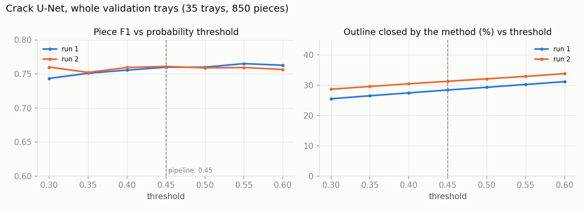
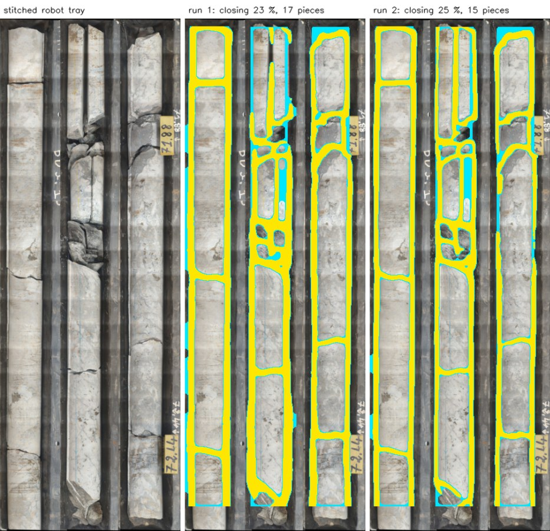

# Crack segmentation: U-Net with ResNet34 encoder

[Project overview](../../../README.md) · [Segmentation](../README.md) · [Pipeline guide](../../../pipeline/README.md)

Draws the outline of every rock piece and every crack across the core. The `contour` RQD method closes these outlines into pieces, and the `connected_components` method cuts the core along the cracks.

| Property | Value |
| --- | --- |
| Task | binary semantic segmentation |
| Architecture | U-Net, ResNet34 encoder ([segmentation_models_pytorch](https://github.com/qubvel-org/segmentation_models.pytorch)), 24.4 M parameters |
| Input | RGB at **10 px/cm**, ImageNet normalisation; 512×512 crops in training, the whole tray at inference (bands of 1,024 rows, sides padded to a multiple of 32) |
| Output | 1 channel of logits → sigmoid → crack probability per pixel, resized back to the original image; crack where p > 0.45 |
| Used in | [pipeline/cracks.py](../../../pipeline/cracks.py) |

## Architecture


*U-Net architecture, from Ronneberger, Fischer and Brox (2015), [U-Net: Convolutional Networks for Biomedical Image Segmentation](https://lmb.informatik.uni-freiburg.de/people/ronneber/u-net/).*

**How this model differs from the figure:**

- The contracting path (left) is a **ResNet34** pretrained on ImageNet: 5 stages with residual blocks, 64 → 64 → 128 → 256 → 512 channels, down to 1/32 of the input.
- The decoder (right) has 5 upsampling blocks (256, 128, 64, 32, 16 channels), each concatenating the encoder stage of the same resolution (the grey arrows).
- Convolutions are padded, so the output has exactly the input size (the original crops it: 572 → 388 px).
- 1 output channel (crack logits) instead of 2.

## Data

188 tray photographs (VNIR, SWIR and MWIR scans of 119 physical trays from 13 GSMI boreholes) with crack masks annotated by me, every one checked by eye. A mask draws a closed outline around each intact piece; rubble is left unoutlined.

**One physical resolution.** Every tray is resized to **10 px/cm**, the median of the training trays, computed from each tray's drilled run (written in its name) and the length of its columns. A 1 cm crack therefore has the same width in pixels in every image, and the pipeline runs the model at that same resolution. 10 px/cm is below what the robot's stitched trays already provide (12.7 px/cm), so no closer or extra photos are needed.

The split is made **by physical tray**, not by image: the scans of one tray in different bands look almost identical, so they all go to the same side. 153 images for training, 35 for validation (850 pieces). Seed 42.

## Training

| Setting | Value |
| --- | --- |
| Encoder weights | ImageNet-pretrained ResNet34 |
| Frozen layers | none: encoder and decoder are trained together |
| Samples | 512×512 crops at 10 px/cm × a random scale between 0.75 and 1.25; 4 crops per tray and epoch |
| Loss | 0.5 × binary cross-entropy + 0.25 × Dice + 0.25 × **clDice** |
| Optimizer | AdamW, lr 3e-4, weight decay 1e-3 |
| Schedule | OneCycleLR (warm-up, then cosine decay to ~0), stepped every batch |
| Batch | 12; mixed precision (AMP), gradient clipping at norm 1.0 |
| Augmentation | flips, brightness/contrast, Gaussian noise; no 90° rotation (trays are always vertical) |
| Checkpoint kept | best **piece F1** on the validation trays, scored every 5 epochs (below) |

**Why clDice.** Dice and BCE barely notice a short break in a line: a 2-pixel hole costs almost nothing, yet it opens the outline of a piece, and the contour method then has to close it itself. clDice ([Shit et al., CVPR 2021](https://arxiv.org/abs/2003.07311)) compares the centre lines: the true centre line must lie inside the prediction and the predicted one inside the truth. On a test stroke losing the same 102 pixels, Dice gives the same penalty to a thinner line and to a broken one (0.019); clDice gives 0 to the thinner line and 0.029 to the broken one.

**Why the checkpoint is chosen on pieces.** What RQD uses is not pixels but the pieces the contour method builds from them. Every 5 epochs, the method runs on the whole validation trays, and its pieces are matched to the pieces of the checked masks (one to one, depth-interval IoU ≥ 0.5).

Two runs are kept:

- **run 1:** a 150-epoch schedule, stopped after 30 epochs without improvement (at epoch 65, before the learning rate decayed); best epoch 35.
- **run 2:** 80 epochs, one full learning-rate cycle; best epoch 55. **The pipeline default** (`crack_unet_resnet34.pth`; run 1 is `crack_unet_resnet34_run1.pth`).

Code: [model.py](model.py) (network, clDice loss), [dataset.py](dataset.py) (resolution and crops), [train.py](train.py) (split, training loop, piece scoring).

## Results

The kept weights of both runs on the 35 validation images, threshold 0.45. Reproduce with [evaluate.py](evaluate.py); all numbers, for every threshold, are in [results/metrics.json](results/metrics.json).

| Run | Piece precision | Piece recall | Piece F1 | Outline closed by the method | Pixel F1 |
| --- | --- | --- | --- | --- | --- |
| run 1 | 0.768 | 0.752 | 0.760 | **28.4 %** | 0.746 |
| **run 2 (pipeline)** | 0.760 | **0.762** | **0.761** | 31.3 % | **0.750** |

*Outline closed by the method:* the share of the final piece outlines that the contour method had to draw itself to close a piece the U-Net left open. The lower, the more of each outline the U-Net drew; the goal is to keep this as small as possible.

### Training


Piece F1 levels off around 0.75 after about 20 epochs in both runs, while the training loss keeps falling. These two runs do not show a clear benefit from a longer schedule. Whether additional data improves performance needs a separate experiment.

### Threshold



Piece F1 is almost flat between thresholds 0.3 and 0.6. A lower threshold lets the U-Net draw a little more of each outline (less closing), at the cost of precision. The pipeline keeps 0.45.

### On a stitched tray from the robot

The U-Net's own masks, without any closing (yellow):


With the pieces' outlines closed by the contour method (cyan = what the method added):



The tray at the top of the [main README](../../../README.md). Both runs trace the long sides of the intact pieces themselves, and nearly every piece of columns 1 and 3 is closed by the U-Net alone. Run 2 draws thinner lines and does not split the broken middle column into small fragments. One fine crack across that column, about two thirds of the way down, is drawn by neither run, so two pieces merge there.

More validation trays: [masks](results/sample_masks_1.jpg), [with closing](results/sample_pieces_1.jpg); [masks](results/sample_masks_2.jpg), [with closing](results/sample_pieces_2.jpg).

**Weak points.** Faint cracks across intact core are sometimes missed. On dark core in a dark tray, the sides of the pieces are often left to the method: there is little contrast between the rock and the tray. The lines are about 17 px wide at 10 px/cm, the width of the annotation strokes; they cut the rock at the right place but eat into the smallest pieces. The validation trays come from the same boreholes as the training trays; new sites are tested directly with the robot.

## Run this model

Install `.[training]` from the project root. Training and evaluation require reviewed records and masks under this model's `completing annotation/data/unified/`, along with the source images referenced by those records. These private inputs are excluded from publication.

```bash
python models/segmentation/cracks_uni/train.py
python models/segmentation/cracks_uni/evaluate.py --runs run2=models/segmentation/cracks_uni/runs/cracks_uni/best_unet.pth
```

The current training script implements the 80-epoch **run 2** schedule and writes to `runs/cracks_uni/` within this model folder. It can overwrite that run's logs and checkpoints. It does not automatically reproduce run 1's historical schedule. Evaluation without `--runs` expects checkpoints for both runs; the single-run command above overwrites `results/metrics.json` with only run 2's evaluation.

Deploy `runs/cracks_uni/best_unet.pth` as `weights/crack_unet_resnet34.pth`. Original histories are [run 1](results/results_run1.csv) and [run 2](results/results_run2.csv).
